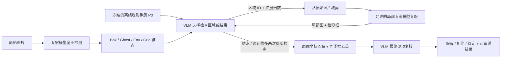

# FacadeFixer InspectAgent

建筑外立面**纯图像主动巡检**工作流。从一张原始图片开始：建立全图锚点，由视觉大模型选择需要放大的区域，最多执行两次原图局部检查，再回映坐标、合并重复候选并逐项复核。

本项目的 GitHub 仓库为 [FacadeFixer_InspectAgent](https://github.com/mo0407/FacadeFixer_InspectAgent)，本机开发目录 `E:\ai\低空\FacadeFixer_IMAGE` 与该仓库是同一项目。代码从 `FacadeFixer_VIDEO` 复制后独立改造，原视频目录继续保留；原视频版说明见 [video-baseline-readme.md](docs/video-baseline-readme.md)。

本机另保留未改造源码归档 `baseline-source-20261118.zip`、来源与文件校验清单 `backup-manifest.json` 及验证记录 `validation-results.json`。这些本机溯源文件不上传至仓库，无法从远端下载；源码归档包含复制时的 81 个源文件与清单，不含模型权重、密钥或运行缓存。

## 图像工作流



同一轮内使用同一份 P0，不在检测途中修改规则。Generator 是本轮的视觉检查者；Reflector、Curator 可沿用既有离线评审接口，为下一版规则准备复盘和候选增量。图中的 YOLOv9e-seg 并未预装，本版通过配置选用已有模型，示例为 `yolo11m` 与 `yolo12m`。

## 快速开始

需要 Python 3.11 或更高版本。克隆仓库后安装并激活环境：

```powershell
git clone https://github.com/mo0407/FacadeFixer_InspectAgent.git
cd FacadeFixer_InspectAgent
python -m venv .venv
.\.venv\Scripts\python.exe -m pip install -e ".[dev]"
.\.venv\Scripts\Activate.ps1
```

先运行不联网、不调用真实检测模型的合成演示：

```powershell
facade-image --workspace workspace image-demo --output-dir examples/generated_image_demo
```

演示中的图片、候选框与模型回答均为测试数据，用于检查裁剪、坐标回映、去重与报告链路，不表示真实建筑的检测效果。

也可复用本机已有 Python 环境，避免改动原视频环境的安装包：

```powershell
Set-Location "E:\ai\低空\FacadeFixer_IMAGE"
$env:PYTHONPATH = (Resolve-Path .\src).Path
& "E:\ai\低空\facade_mcp_langchain\.venv\Scripts\python.exe" -m facade_mcp.cli --workspace workspace image-demo --output-dir examples/generated_image_demo
```

## 处理自己的图片

1. 在 [image-inspection.example.json](examples/image-inspection.example.json) 中填写图片路径，以及要使用的专家模型。
2. 配好本地模型环境。当前已有 FacadeFixer 源码、权重与独立模型 Python 环境可通过环境变量指定。
3. 配置支持图片输入的 VLM；远程执行需要配置文件中的 `api_enabled=true`，并在命令中显式加入 `--allow-api`。

```powershell
$env:FACADE_SOURCE_REPO = "E:\ai\低空\项目代码\FacadeFixer-main"
$env:FACADE_SOURCE_PYTHON = "E:\ai\低空\项目代码\FacadeFixer-main\.venv\Scripts\python.exe"
$env:FACADE_SOURCE_DEVICE = "cpu"

facade-image --workspace workspace image-inspect --config examples/image-inspection.example.json --model-config examples/image-models.mock.json --playbook examples/image-playbook.json
```

这里的 `image-models.mock.json` 只替代 VLM 决策，`image-inspect` 仍会调用配置的本地专家模型。要完整离线检查基础链路，请使用 `image-demo`。

真实 VLM 可从 [image-models.remote.example.json](examples/image-models.remote.example.json) 开始配置，格式沿用 [三角色模型网关](docs/model-gateway-v1.md)：连接可选择 `chat_completions` 或 `responses`，图像连接必须设 `supports_images=true`。端点和密钥通过环境变量读取，配置文件不保存密钥。使用远程 VLM 会向该服务商发送本轮图片证据、候选信息和规则手册。

## 作为 MCP 使用

安装后可启动 `facade-image-mcp`，或直接执行 `python -m facade_mcp.image_server`，以 stdio 方式接入支持 MCP 的客户端。高层工具 `facade_image_inspect` 接收 `request` 对象、`model_config_path`、可选的 `playbook_path` 和默认关闭的 `allow_api`。本地专家检测继续通过已有 model MCP 调用。

可用 `facade-image --workspace workspace mcp-config --include-image --output mcp.local.json` 导出包含图像入口的客户端配置。这个文件包含本机路径，保存在本地使用。

模型配置和规则文件须位于允许的输入目录内。使用该工具不需要网页或 HTTP 服务；旧 Web 工作台仍在副本中保留。

## 结果如何理解

- 全图锚点保留原图坐标与来源；局部检测框通过裁剪偏移回到原图，不从缩略图反推坐标。
- 最终复核区分 `keep`、`reject`、`defer`。`keep` 是模型保留的候选，仍需人工验收。
- 每个候选展示原图定位和原像素局部图；原始证据、规则快照、模型调用与局部检查记录随任务保存，可用于复盘。
- 可以提供与原图等尺寸的二值墙面范围 mask，将门、窗、外楼梯和背景排除。未提供范围 mask 时，不应把检测结果视为已经完成人工范围复核。
- 没有独立人工真值时，不输出准确率、召回率或“已达标”的结论。合成演示只验证程序行为。

参数、输入输出约定及当前限制见 [图像工作流说明](docs/image-workflow.md)。原有视频、分割、报告、评审与看板模块保留在副本中，便于继续复用；本轮新增主流程聚焦图像锚点与框级主动检查。

## 失败记录与同因统计

运行失败、已确认的质量问题和待复核观测分别归档到本地失败记忆库，观测不计入失败数量，mock 视觉输出不进入观测统计。可以查看哪些原因反复出现、涉及哪些任务，并用有证据的人工反馈补充漏检、误报、框偏差等质量问题。没有真值或可靠复核依据时，不把可疑现象直接算成漏检或误报；Reflector 的原因解释保留为推测。

```powershell
facade-image --workspace workspace failure-summary --output failure-dashboard.html
facade-image --workspace workspace failure-feedback --config examples/image-feedback.example.json
```

反馈示例中的任务 ID 和证据文件须替换为本地真实产物。重复原因采用固定代码聚合，同一事件幂等提交不重复计数；规则不会因此自动更新，也不会触发付费重跑。详见 [失败记忆说明](docs/failure-memory.md)。

## 测试

```powershell
python -m pytest -q
```
