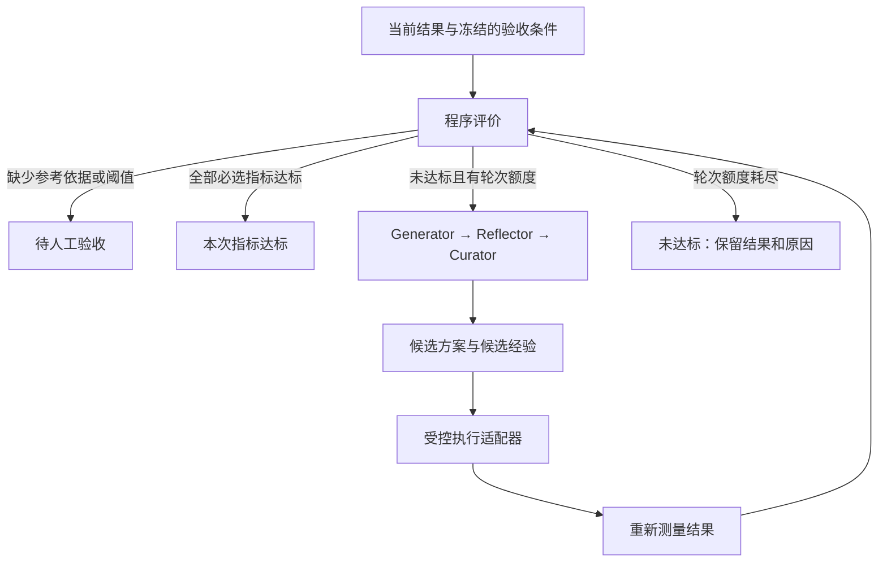

# 评价与调优控制器 V1

后续已补充[真实视频 MCP 准备适配器](video-preparation-v1.md)：按 1 fps 分批抽帧、合并清单并验证墙面范围复核；完整检测与评价回调仍待接入。

本阶段在三角色评审基础上补充像素评价器和可调用的调优控制器。视频 MCP 的自动执行适配器尚未接入；本阶段不代表已完成原视频重新分析。

## 实际执行路径



### Mask 评价

命令 `evaluate-masks --request 配对清单.json --output 评价结果.json` 按人工指定的同一缺陷配对计算 Dice 和 IoU。相对图片路径以清单所在目录解析。

```json
{
  "dataset_version": "人工标注集-v1",
  "reference_approved_by": "复核人员标识",
  "pairs": [
    {"instance_id": "C01", "prediction": "pred/C01.png", "reference": "truth/C01.png"}
  ]
}
```

要求单通道二值图（0/1 或 0/255）、尺寸一致、正样本参考 mask 非空。预测全空时计零分。输出逐实例 Dice/IoU、实例宏平均、文件 SHA256 和尺寸。不自动缩放或配准，避免通过变换掩盖坐标错误。

这里评价的是清单中已配对的正样本分割质量。清单应包含完整评测实例，漏分割应提交全空预测；该命令无法发现清单外被遗漏的缺陷或额外误报，不能替代检测召回率、精确率，也不能作为整份报告验收。`reference_approved_by` 是调用方声明，不是身份认证；还需要人工复核参考标注的准确性与配对关系。

### 调优控制器

Python 接口 `run_optimization(config, initial, output, execute_and_measure, max_experiments=..., allow_api=False)`。

- `initial` 使用已有 `ReviewRequest`。必选指标缺少值、阈值、参考确认或证据时停在 `pending_review`，即使其他指标已经失败。
- `execute_and_measure(proposal, current)` 是异步回调。接收结构化计划、反思和评审目录，执行支持的参数修改，独立重新测量，再返回 `ReviewRequest`。不得把模型输出作为任意命令执行。
- task、指标集合、阈值、方向、必选状态、验收版本和经验库版本冻结；回调改变这些字段会失败。实际适配器还必须固定评测集版本及范围，不能通过删掉难例提高分数。
- `max_experiments` 为 1–20 的明确上限。上限是执行次数，不是成功标准。最多每轮三个模型调用，每次调用的 token 和超时沿用模型配置。尚无累计金额预算器。
- 全部必选指标通过返回 `targets_met`；额度用尽返回 `budget_exhausted`；错误保存 `failed` 后抛出，不自动重试。`targets_met` 仅表示提供的指标达标，不表示报告已生成或经过独立验收。
- 每轮保存输入、评价、三角色评审路径及最终停止原因。经验始终为候选，不自动晋升。当前没有自动恢复、最优轮次回滚、跨任务经验检索与独立验证集晋升。

控制器依赖执行适配器提供可信测量。生产接入时要让适配器读取实际评价器输出，并固定评测集、禁止重复使用原分数。当前不应直接信任模型生成的分数。

## 无 API 演练

在仓库目录运行（先将 `src` 加入 `PYTHONPATH`，或安装项目）：

```powershell
$env:PYTHONPATH = "$PWD\src"
python examples/optimization_mask_demo.py --output ..\workflow-evaluations\mask-loop-demo
```

输出目录必须不存在，防止覆盖已有演练。演练用合成 32×32 mask，从空预测开始，经一次回调再次测量达标。回调故意复制参考图，只验证程序控制流，**不属于模型优化成果，也不证明真实建筑检测效果**。0.9 是演练阈值，不改变待确认的正式验收标准。

## 下一步接入

每轮保存状态时会刷新同目录的 `dashboard.html`。在浏览器刷新页面可查看基线、逐轮测量值、验收阈值、较上一轮和较基线的改善。指标有越低越好的情况，页面统一把有利变化显示为正数。页面也区分候选规则和调用方提供的已采用规则快照。

看板由达标摘要、轮次列表、报告、指标、模型参数和规则库组成。点击左栏轮次，右栏切换到该轮记录。调用方可给基线传入 `initial_details=RoundDetails(...)`，也可在回调中返回 `RoundResult(request, details)`。旧回调继续返回 `ReviewRequest` 即可。报告应保存到回调的 `proposal["run_folder"]` 下，`details.report` 填相对路径，例如 `reports/round-2.html`。模型配置通过 `details.models` 记录各阶段实际使用的模型和参数。缺少记录时显示为空，报告路径和模型参数仅用于看板展示，不会作为评审模型输入。

已有运行可用 `python -m facade_mcp.cli optimization-dashboard --state <state.json> --output <dashboard.html>` 导出。可追加 `--playbook <规则快照.json>`，格式为 `{"version":"运行记录中的 playbook_version","rules":[{"condition":"适用条件","recommendation":"已采用规则","evidence_ids":["证据标识"]}]}`。看板展示给定规则快照，规则的采用仍由既有审核流程决定。

实际视频适配器应执行：1 fps 抽帧 → 目标建筑墙面范围审核 → 检测与跨帧去重 → 分割 → 参考集评价 → 按失败环节重跑 → Report MCP 格式报告。门、窗、外楼梯与背景建筑排除；采用已确认的九类业务标签。当前旧运行时分类映射尚需迁移，不能宣称已完全遵循新的九类标准。
