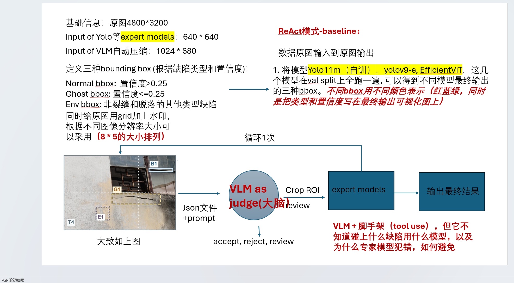
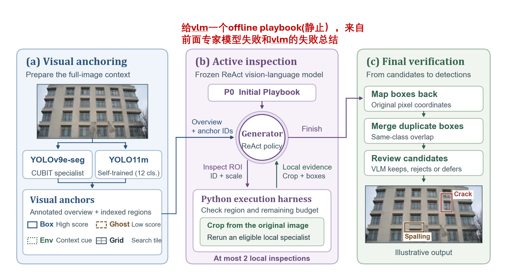
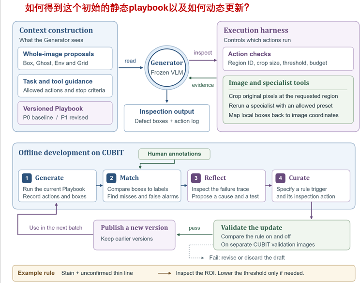

# 三图需求对照与验收

核对日期：2026-11-19。核对代码基线：`20705b7`。

当前版本具备单图主动检查、失败记忆和离线 P0 配对验证与发布框架。三张图还规定了独立 baseline、具体框语义、首轮失败材料生成及逐条规则验证，当前尚未完整实现这些实验约定。

## 三张图的关系

- 图 1 是 ReAct baseline：固定输入协议与专家组合，在 val split 上执行并保存结果，按 Normal、Ghost、Env 展示候选，review 分支进行一次局部检查。
- 图 2 是带离线 Playbook 的主动检查：全图锚点、冻结 P0、原像素局部工具、最多两次检查、坐标回映、去重及最终核验。
- 图 3 说明 P0 的开发与更新：人工标注开发集上的 Generate、Match、Reflect、Curate，再用独立验证图像检查规则开关效果，通过后发布下一版本，供下一批次使用。

图 1 的 Env 是“非裂缝、非脱落的其他缺陷”；图 2 的 Env 是环境上下文。实现时需要保留明确的模式或语义字段，不能把两种 Env 当成同一种框。

## Baseline 与主动检查对照

| 要求 | 当前实现 | 状态及待补内容 |
| --- | --- | --- |
| 原图 4800×3200，结果回到原图坐标 | 原图尺寸可变，保留存储像素坐标、输入哈希和局部偏移 | 已具备原图回映；4800×3200 是图示样本，不应强制缩改所有原图 |
| 专家输入 640×640 | `inference_size` 默认 960，可设 640 | 部分具备；参数 640 不等于所有后端实际张量均为 640×640，严格实验还需固定 letterbox/rect 策略并记录实际输入形状 |
| VLM 约 1024×680 | 概览按最长边 1280 等比缩小，候选局部最长边 2048；上传图像尺寸已记入 model_trace.json | 待增加可复现的 VLM 输入尺寸协议；本地上传尺寸记录不能保证服务商后续自动缩放的尺寸 |
| Normal >0.25，Ghost ≤0.25 | 默认低阈值 0.1、高阈值 0.5，`score >= high_threshold` 为 Box | 待增加 baseline 边界语义；只把高阈值改成 0.25 仍会把恰好 0.25 归为 Box。低于 0.1 的框当前已被过滤，不能称为全部 Ghost |
| 其他缺陷作为 Env | 当前其他业务缺陷仍按分数生成 Box/Ghost；Env 来自 scope mask、VLM 场景分析或手工上下文 | 待增加图 1 的缺陷上下文语义，并与图 2 的场景 Env 分开 |
| 原图 8 列×5 行网格水印 | 默认 3×3，行、列上限均为 6 | 待修改网格范围与对应可视化，当前无法配置 8 列 |
| 红蓝绿框，图上显示类型与置信度；图 2 使用实线、虚线、点线区分 | 概览使用蓝、橙、紫、灰实线，主要显示锚点 ID | 待补三类框样式、类别和分数标签；JSON 中保存分数不等于图上已显示 |
| YOLO11m、YOLOv9-e、EfficientViT 在 val split 各跑一次 | 默认 YOLO11m、YOLO12m；可注册 Ultralytics 或 YOLOv9-seg 专家 | 待补 EfficientViT 具体任务与 checkpoint 的适配，以及统一逐专家 baseline 批评测入口；已有 YOLOv9-seg 接口不证明指定 CUBIT 权重已安装或验收 |
| Baseline 先 accept/reject/review，review 才进入一次裁剪复查 | 当前局部动作是 inspect/finish，默认最多两次，最终统一 keep/reject/defer | 部分具备；`max_inspections=1` 可限制一次工具检查，但仍不是完整的图 1 判决时序 |
| 按合格专家执行局部检查，回映、去重、最终核验 | 检查锚点 ID、类别/范围资格、预算、重复动作、权重与实现身份；动态注册局部新框 | 代码已具备；仍需实际专家权重与视觉 API 的真实场景验收 |

对应代码：[图像主流程](../src/facade_mcp/image_inspection.py)、[专家注册](../src/facade_mcp/expert_registry.py)、[模型服务](../src/facade_mcp/model_service.py)、[注册专家执行器](../src/facade_mcp/registered_expert_worker.py)。

## 初始 P0 与动态更新对照

| 要求 | 当前实现 | 状态及待补内容 |
| --- | --- | --- |
| 无历史时，从人工标注开发集运行当前策略，建立初始失败材料 | 图像检查可用手工 P0 或 P0-empty 启动；`rule-propose` 需要已有合格历史，`rule-cycle` 先 propose 再 validate | 待增加独立的 Generate→Match 启动入口；目前不能直接从空历史自动完成图 3 首轮 |
| Match 明确找出每个漏检与误报 | 已有同类 bbox 一对一匹配、匹配索引和 TP/FP/FN 计数，并保存每 case 的结果 | 部分具备；待输出逐实例 FP/FN 清单，并自动登记带原图、候选/GT 编号和动作轨迹的失败事件。人工反馈入口已可登记漏检、误报 |
| Reflect 总结失败，Curate 形成触发条件与检查动作 | 已有带证据引用的 hypothesis、受控改动、condition、recommendation 和版本化候选规则 | 已具备文本规则提案；解释仍是待验证假设，不能按出现次数直接认定为根因 |
| Harness 检查 region、crop、threshold、budget；必要时降低阈值 | 当前允许选择 anchor_id、model_profile、scale，阈值固定为本次请求的 low_threshold | 待增加 action preset/阈值白名单及执行校验。自然语言规则写“降低阈值”不会自动改变本次工具阈值 |
| 在独立验证集逐条比较 rule on/off | 当前每个 case 比较整本 parent P0 与 candidate P0；一次候选可改多条规则 | 待补逐条规则消融或严格单规则更新模式；只有一次恰好一条变动时，整本配对才可能对应单条规则对比 |
| 验证失败后 revise 或 discard，并受控重测 | 当前失败不发布，保留旧 P0、候选、指标与失败记录；rule-cycle 只执行一次提案与验证 | 已具备不采用失败候选的边界；待补显式淘汰/修订状态及有轮次、调用量和停止条件的重测控制器 |
| 通过后发布新版本、保留旧版本、下一批次采用 | 已有独立参考校验、改善门槛、来源与身份绑定、父版本并发检查、不可变版本和 latest 加载 | 代码已具备；mock、模拟 HTTP 和注入 runner 不会发布正式版本 |
| 当前 Generator 的 P0 保持静态 | 每次检查开始加载并深拷贝规则、保存 hash；新版本只影响后续任务 | 已实现；动态更新发生在任务之外，不修改正在运行的 P0 |

对应代码：[规则生命周期](../src/facade_mcp/rule_lifecycle.py)、[规则与增量](../src/facade_mcp/playbook.py)、[失败事件接入](../src/facade_mcp/image_failures.py)、[持久计数](../src/facade_mcp/failure_memory.py)、[CLI](../src/facade_mcp/cli.py)。

## 验收条件

以下是后续实现需要满足的验收目标，不是当前已交付的命令或已测得的效果。

1. **Baseline 可复现。**记录数据划分、专家 checkpoint、真实输入尺寸、框语义、0.25 等号边界、网格和一次 review 分支；逐专家结果与整体结果分别输出。
2. **首轮 P0 可建立。**从有人工标注的开发集生成带来源的逐实例误报/漏检，复盘能引用具体失败与动作 trace；空历史不能靠虚构错误启动。
3. **规则动作可执行。**规则引用的模型与阈值 preset 受 harness 白名单限制，超预算或越界动作被拒绝；每次参数变更都写入轨迹。
4. **规则增益可归因。**逐条开关时固定同一批图、模型身份、分辨率、阈值策略与工具预算。不能把 baseline 一次与增强模式两次检查的全部差异归因给 P0。
5. **开发与验证隔离。**已用于复盘修订的图像不能反复充当独立验收集；按建筑、拍摄批次或序列规划划分并保留来源。代码现有同源哈希排除不等于已自动证明跨建筑隔离。
6. **失败修订有界。**记录修订轮次、使用数据与停止原因；目标未达时保持正式 P0 稳定，达到预算后明确结束，不承诺一定收敛。
7. **真实验收有材料。**配置实际 YOLOv9-e/CUBIT、YOLO11m、EfficientViT 对应任务与权重，完成真实视觉 API 检查及人工参考测试；程序单测不替代检测准确率验证。

现有接口的使用方式见 [完整图像流程说明](complete-image-workflow.md)。

## 原始需求图

### 图 1 ReAct baseline

### 图 2 带离线 Playbook 的主动检查

### 图 3 初始规则构建与离线更新

