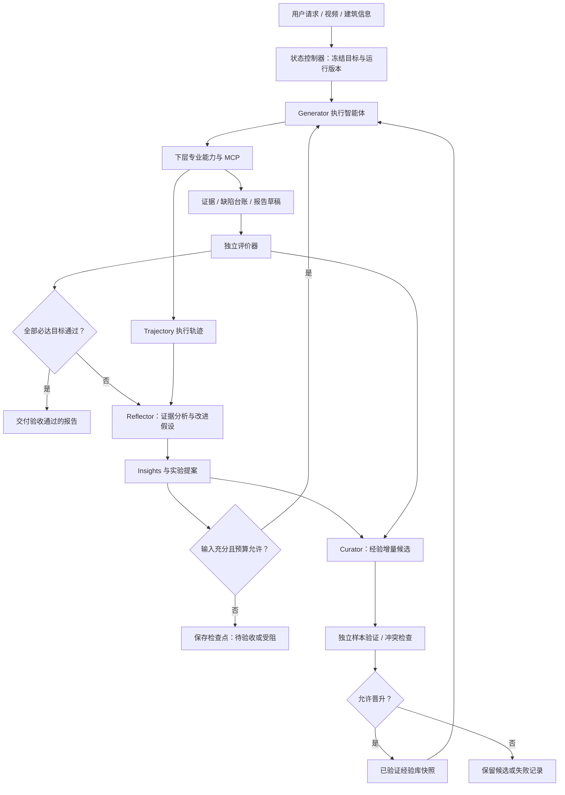

# 两层模型体系与视频报告调优闭环 V1

日期：2026-11-08。性质：开发架构设计，不代表本文件描述的运行时已经实现。

实现进度：已新增模型网关与单次文本评审，见 [使用说明](model-gateway-v1.md)。图像版另已接入 PNG/JPEG 多模态输入及有界主动检查，见 [图像工作流](image-workflow.md)。下述视频自主闭环、跨帧实体关联与自动经验晋升仍是开发目标。

关联标准：[评价与标注标准 V1](evaluation-standard-v1.md)。当前可读取的模型连接示例为 [三角色 mock 配置](../examples/model-gateway.mock.json)、[三角色远程配置](../examples/model-gateway.remote.json) 和 [图像远程连接配置](../examples/image-models.remote.example.json)。模型连接与工作流请求分别配置；这些示例不代表完整两层自主闭环已经实现，也不是本文件下述统一架构契约的实现。

## 1. 目标与总体原则

输入原始视频、目标建筑信息、用户要求和验收目标，输出目标建筑范围内的缺陷台账、bbox、Mask、定位图与指定格式报告。支持不同角色调用不同供应商的大模型 API，支持各类检测和分割模型独立配置。

闭环对应用户参考图：Query + Context Playbook → Generator → Trajectory → Reflector → Insights → Curator → Delta Context Items → Context Playbook。

- 上层是认知与协作层：决定如何执行、为何失败、哪些经验可复用。
- 下层是专业能力层：执行视频处理、建筑定位、检测、分割、评价与报告渲染。
- 独立评价器和状态控制器提供验收约束，不让 Generator 自行决定是否达标。
- 多智能体不等于多个模型副本；角色、模型连接、工具权限和记忆分别配置。
- 业务类别固定为 C/S/T/R/D/V/L/E/B；外楼梯、门、窗排除。楼梯后方建筑墙面与门窗周边建筑墙体按范围标准处理。

## 2. 总体流程

失败调优与经验入库是两条路径：具体改动可以在当前任务中试验，但未经验证不能成为所有项目的默认经验。当前 run 固定经验版本；新经验通常供下一轮显式启动的实验或下一任务使用，不在执行中悄悄改变上下文。

## 3. 上层：三个核心模型角色

| 角色 | 输入 | 输出 | 权限边界 |
|---|---|---|---|
| Generator | 请求、冻结目标、范围规则、经验快照、当前状态、失败项 | 步骤计划、工具调用、结构化产物、简明决策依据 | 可调用授权 MCP；不可修改真值、门槛或批准经验 |
| Reflector | 执行轨迹、评价结果、选定原图/bbox/Mask、历史实验摘要 | 失败归因、改进假设、最小实验、预期指标变化 | 默认只读；不直接覆盖结果，不把自己的偏好作为真值 |
| Curator | 经评价的实验、用户修订、经验库候选与适用条件 | add/revise/deprecate 类型的经验增量提案 | 可写候选区；不能自行更改冻结目标或直接晋升正式经验 |

Generator 可以内部拆成视频、检测、Mask、报告子任务，但第一版不必为每一步创建独立智能体。独立任务可并行；有依赖的产物先验证再进入下游。

Reflector 可有限次自检：核对引用证据、检查假设是否与工具日志矛盾。只有实际重新执行并经评价器测量后，才算一次有效调优实验；单纯多写一段反思不能计作性能改善。

状态控制器由程序实现：维护依赖、检查点、预算、回滚与验收门槛。它不需要第四个大模型来替代确定性判断。

## 4. 下层：专业模型和 MCP 工具

| 阶段 | 输入 | 能力/工具 | 输出 |
|---|---|---|---|
| 视频检查 | 视频路径、元数据 | Video MCP inspect | 源哈希、分辨率、时长、帧率 |
| 抽帧 | 视频、1fps 策略、补采时间段 | Video MCP extract | 原尺寸帧、真实帧号与时间戳 |
| 建筑聚焦 | 目标建筑信息、原帧、镜头分段 | 待新增 Scope 适配层，可接视觉模型/检测分割跟踪模型 | 建筑范围、排除对象、归属不确定区、坐标变换 |
| 缺陷检测 | 建筑 ROI、模型配置、类别标准 | Model MCP，已有本地检测能力 | 原始标签与规范化标签、bbox、分数、模型来源 |
| 跨帧关联 | 候选、地标、帧时间与视角 | 待新增关联编排，结合视觉复核 | physical_location_id、去重实例、代表图 |
| Mask | 原帧、实例、bbox、点/文本提示 | Model / Mask MCP，各分割后端 | 实例二值 Mask、叠加、RLE、来源与方法 |
| 立面与定位 | 连续同面图像、可靠变换 | Video MCP 总览能力 + 配准适配层 | 总览、原帧位置索引、覆盖与配准质量记录 |
| 台账整理 | 经复核的缺陷和证据 | Video MCP curate | 版本化台账、定位图、局部图 |
| 报告 | 台账、Mask、项目资料、模板版本 | 待新增规范化转换器 → Report MCP | 指定格式草稿、校验结果、HTML/PDF 导出 |
| 评价 | 输出、冻结标准、参考标注 | 待新增 Evaluator | 分项结果、失败清单、证据充分性 |

纯视频任务不强制先执行建筑坐标或航线规划。用户提供已有视频时直接进入视频链路；有建筑/航线资料则作为范围和来源信息输入。图片输入也可从建筑聚焦阶段接入。

专业模型和上层 API 模型相互独立。Generator 换模型不等于 YOLO 或分割权重变化。视觉大模型可以辅助建筑归属、类别复核或生成分割引导，但不能把解释文本冒充像素分割结果。

## 5. 多供应商 API 接入契约

新增统一 ModelGateway，按配置选择 provider adapter。可规划原生供应商适配器和兼容协议适配器；不能假设所有大模型 API 都接受同一种请求格式。

建议统一方法：invoke(role, messages, artifacts, output_schema, budget) → ModelResult。这是待实现接口，不是现有 SDK 方法。

ModelResult 至少包含：provider_id、requested_model、实际响应模型标识（若有）、request_id、输出、结构校验状态、usage、费用（未知则 null）、耗时、finish_reason、失败类别。

每个模型连接声明能力：text、image_input、structured_output、tool_calling、上下文限制、图片限制、允许的数据类型。运行前做能力与格式探测，不仅检查网络连通性。

- Generator 需要工具规划能力；可由模型原生 tool calling 或结构化计划加本地校验执行器实现。后一种必须明确标记。
- Reflector 涉及图像判断时必须能读取原图与叠加图，不能只看另一模型的文字摘要。
- Curator 主要要求结构化提取与规则归纳，通常不必接收整段视频。
- 如需 LLM 语义评价，可另配 judge 模型，但其结果是辅助评分；不替代标注和确定性技术检查。
- 各模型的工具调用与返回格式由 adapter 映射，消息内容中的文件路径、网页文字均视为数据，不能成为工具权限指令。

连接配置只存 key_env 等密钥引用，API key 不进入报告、轨迹或版本库。每个角色只获得自己需要的凭据。发送到外部 API 的图片、日志与字段由出站策略限定；默认只发送必要证据，不自动上传全部视频。

故障路由：429/可重试服务错误按策略退避；超时可能已计费，记录请求 ID/未知状态，不能无条件重复付费请求。更换供应商或模型必须在实验轨迹中显式记录。原生结构化输出不可用时，可执行有限次格式修复；不能捏造缺失的工具结果。

## 6. 固定流程与模型自主判断边界

程序固定：输入快照 → 范围判定 → 检测 → 关联 → 分割 → 台账 → 报告 → 评价。独立步骤允许并行，已满足的前置条件可以复用。

Generator 可在允许范围内选择：抽帧补采区间、检测模型、分块尺寸、分割模型、提示模式、重试对象、代表图候选。

不能自主变更：检测范围、九类标准、参考真值、验收门槛、原始证据、预算上限和经验晋升权限。模型提出扩大范围或改变标准时记为待确认需求，不暗中执行。

模型路由按显式规则初始化，再通过实验调优：

- 小目标或疑似漏检：局部原像素分块，再比较候选检测模型。
- 模型类别与材质冲突：视觉复核，保留原标签；不能直接认定混凝土裂缝。
- 面状缺陷：框提示为候选策略，必要时点/文本提示比较。
- 细线：使用细线适用的分割策略，检查连通性与带外吸附。
- B 类几何证据不足：观察项/待补拍，不自动切成普通污渍 Mask。
- 建筑身份不确定：退回范围阶段；不能靠缺陷模型高分绕过。

三种提示比较结果是候选结果的比较，不是三次独立真值验证。不同模型分歧进入诊断或人工队列，不简单多数投票。

## 7. 执行轨迹和业务数据契约

统一业务对象建议：

| 对象 | 必要字段 |
|---|---|
| RunSpec | run_id、视频哈希、building_id、scope_version、taxonomy_version、acceptance_version、template_version、playbook_version、model_config_hash、预算 |
| FrameAsset | source_video_id、frame_index、timestamp、width/height、image_hash、可评价状态 |
| ScopeResult | 目标建筑 ROI/Mask、排除对象、unknown_regions、原图到裁剪图变换、人工确认状态 |
| DefectInstance | instance_id、physical_location_id、业务类别、原始模型类别、构件、材质、状态、bbox、evidence_ids |
| Segmentation | instance_id、mask_asset、RLE、坐标空间、方法、模型/提示版本、像素检查、边界不确定性 |
| EvaluationResult | metric_id、value、threshold、pass/fail/pending/N/A、参考集版本、样本数、失败证据 |
| Experiment | parent_run、hypothesis、controlled_change、复用资产、指标变化、预算消耗、接受/回滚理由 |

Trajectory 保存工具调用顺序、输入输出资产引用、模型版本、参数、错误、耗时和简明决策依据。不要求保存模型隐藏思维链；也不把长聊天全文当作可复现轨迹。密钥与敏感请求头必须脱敏。

MCP 返回 status=failed 或产物校验失败时不得继续使用半成品。报告由版本化台账渲染；文字修改、bbox 修订和 Mask 替换都必须能追溯到原证据。

## 8. 未达标继续优化的执行规则

1. 评价器先判断目标是否可评价。缺少真值时给 pending，不能用模型偏好替代精确率/召回率。
2. Reflector 对失败项生成结构化假设：failure_id、证据、可能原因、拟改变因素、预期改善指标、可能退步项。
3. 控制器校验计划是否越权，是否超预算，是否与已失败实验重复。
4. 每轮优先只改变一个主要因素；执行最小受影响子图。
5. 重新评价受影响指标，并检查此前已通过的关键项没有退步。
6. 改善且没有不可接受退步则接受；否则回滚当前产物引用，保存失败实验。
7. 所有必达项通过且必要人工验收完成才标记 pass。

示例依赖失效范围：范围变化→检测及其下游；检测类别/bbox变化→关联、Mask、报告和评价；Mask参数变化→Mask、报告和评价；模板变化→报告和报告评价。原视频抽帧不受模板变化影响。

缓存键包括源哈希、步骤版本、模型/权重版本、参数、提示、上游资产哈希与相关标准版本，不能仅按文件名缓存。

状态为 optimizing、pending_review、blocked、pass。预算耗尽或连续无改善时保存检查点，不下调阈值、不假称完成。具体阈值与连续无改善轮数尚待确认；示例配置中的值不是正式验收承诺。

## 9. 经验库与 Curator 的增量更新

经验分三层：

- 项目事实：建筑身份、立面命名、用户排除对象；不跨项目自动传播。
- 案例记录：某张图的引导点、bbox、参数与失败；可检索，不当通用规则。
- 策略经验：明确条件下的抽帧、模型路由、提示或复核规则；独立验证后晋升。

每条经验包含 id/version、适用条件、建议动作、反例、支持实验、验证数据、改善与代价、冲突规则、状态、创建者与批准者。禁止把旧 Mask 当作新的真值，禁止把逐图阈值包装成所有墙面的默认参数。

Curator 输出 Delta Context Items：add/revise/deprecate。更新必须引用父版本，经历 schema 校验、证据检查、范围检查、冲突检查和独立验证。正式版本可回滚；并发更新通过版本冲突检查提交，不能最后写入者无条件覆盖。

同一原视频与剪辑版、相邻帧应分在同一数据组。Reflector 只能根据开发集失败细节调优；冻结测试集不开放给其反复查看和修补。正式经验至少记录在什么独立数据上验证过。

## 10. 报告输出与用户反馈

报告沿用用户指定仓库的模板结构，逐缺陷展示定位图、局部图、Mask 和叠加图；按范围排除门窗及外楼梯，不将观察项当确认缺陷。项目要求的报告必填项在冻结模板中定义。

报告中可展示方法、覆盖范围、未达标项及候选状态；不要把内部全部提示词和 API 细节堆进用户正文。详细轨迹放在可审计的附件/实验记录。

用户修改被保存为结构化 feedback：对象ID、修改前后、修改原因、修改者、时间、审核状态。用户偏好、图像标注修订与现场专家确认分开存储。只有符合真值资格的修订才进入评测或后续训练集。

## 11. 与现有仓库的对应关系

| 当前文件/能力 | 可复用部分 | 需要新增或调整 |
|---|---|---|
| orchestration.py | LangGraph、ToolGateway、MCP配置、调用轨迹 | 视频状态图、循环控制、受影响子图重跑、结构化检查点 |
| video_server/service.py | 检查、抽帧、变换、总览、台账、导出 | 1fps 分批调度；建筑归属和关联不假装已自动实现 |
| model_server/service.py | 本地检测与分割模型工具 | 按类别/失败类型路由，统一业务标准映射 |
| mask_server/service.py | 分割与精修工具 | 稳定原图坐标契约、失败策略、分类适配 |
| prompt_selection.py | bbox/point/text 比较、可选远程评判 | 与多供应商网关及实验记录衔接；保留费用/出站限制 |
| report_server/service.py | 报告草稿与校验 | Video台账→Report输入的正式转换器、固定模板输出与验收 |
| storage.py | 资产存储与引用 | Run/Experiment/Playbook版本索引和检查点 |
| taxonomy.py | 原始标签保留、部分规范化 | S/P合并、B支持、语义适配与迁移验证 |

建议新增模块：model_gateway、provider_adapters、video_workflow、scope_service、association_service、report_adapter、evaluation、reflection、playbook_store、experiment_store。模块名为开发建议，不是已存在文件。

## 12. 开发顺序与验收

第一阶段：冻结试标规则和目标配置；实现统一状态/资产契约、模型网关的模拟适配器、单次视频链路。先用模拟服务验证格式和权限，不要求立即提供真实 API key。

第二阶段：接入实际 API，分别测试文字/图片输入、结构化输出、超时、费用未知、供应商切换与密钥脱敏。真实调用费用和出站范围由运行配置显式启用。

第三阶段：接入独立评价器、Reflector、受影响步骤重跑和回滚。用刻意构造的漏检、背景误收、错位 Mask 和坏报告验证失败能被发现且不能伪装通过。

第四阶段：接入 Curator 候选经验区、独立验证及晋升流程；通过实验验证经验冲突、退步拒绝、并发更新和版本回滚。

系统验收需证明：角色可以独立更换模型；失败可恢复；产物可追溯；修改模板不会重跑视频；门槛不可被智能体修改；没有真值时显示待验收；未验证经验不能成为默认规则。性能指标的门槛沿用评价标准，尚未确定的保持 TBD。
